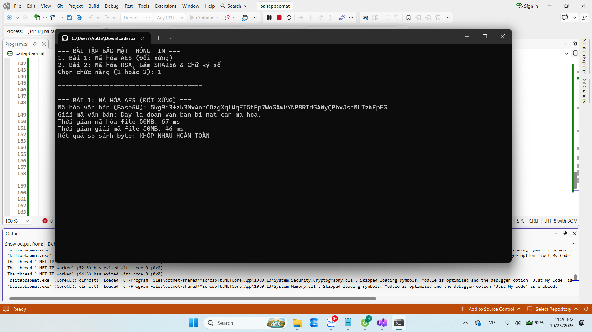
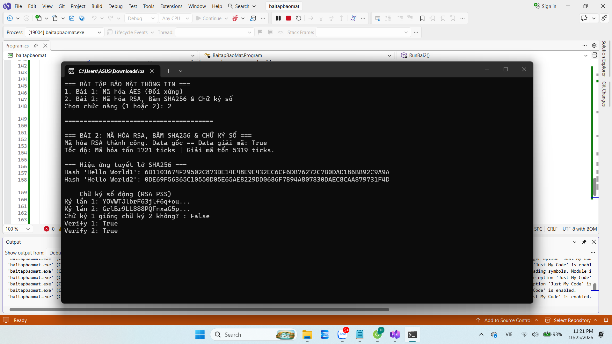

# Bài Tập An Toàn và Bảo Mật Thông Tin - AES & RSA

## Cài Đặt và Chạy Thử
1. Mở file solution (`.sln`) bằng Visual Studio.
2. Nhấn **F5** để khởi chạy chương trình trên màn hình Console.
3. Nhập 1 hoặc 2 từ bàn phím để chọn chạy Bài 1 hoặc Bài 2.

## Bài 1: Mã Hóa Đối Xứng (AES)
* **Hiệu năng:** Thuật toán AES mã hóa luồng rất nhanh, xử lý file dữ liệu dung lượng lớn (50MB) chỉ trong vài mili-giây.
* **So sánh:** Tốc độ mã hóa và giải mã tương đương nhau. Dữ liệu sau giải mã khớp hoàn toàn với file gốc ban đầu.

## Bài 2: Mã Hóa Bất Đối Xứng (RSA) và Chữ Ký Số
* **Tốc độ mã hóa RSA:** Mã hóa bằng Public Key (số mũ e nhỏ) rất nhanh, giải mã bằng Private Key (số mũ d lớn) tốn nhiều thời gian hơn đáng kể.
* **Hàm băm (SHA256):** Dữ liệu đầu vào chỉ thay đổi 1 ký tự cũng làm thay đổi hoàn toàn chuỗi băm đầu ra (hiệu ứng tuyết lở).
* **Chữ ký số động:** Sử dụng cơ chế đệm **RSA-PSS** (Probabilistic Signature Scheme) để tự động thêm nhiễu ngẫu nhiên (salt) vào hàm băm trước khi ký. Nhờ đó, cùng một dữ liệu và cùng một người ký sẽ cho ra các chữ ký khác nhau ở mỗi lần ký, nhưng hệ thống vẫn xác minh (verify) hợp lệ bằng Public Key.

